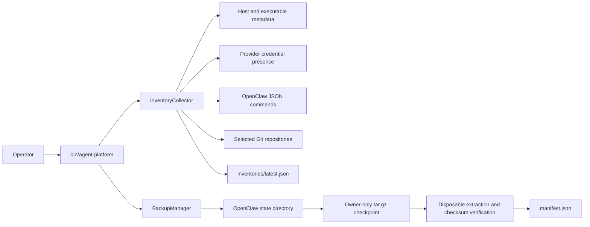

<p align="center">
  <a href="pyproject.toml"></a>
  
  
  <a href="LICENSE"></a>
</p>

# Agent Control Plane Infrastructure

Operational plans and safety-focused automation for an ECC + OpenClaw multiplayer coding platform. The repository currently provides two working commands: a sanitized local inventory collector and a verified OpenClaw state backup tool. It also holds the migration specification, progress ledger, operator decisions, and validation evidence for the wider platform.

The implementation is intentionally small. It does not run the orchestrator, dispatch coding agents, or store credentials. Runtime orchestration lives in [`openclaw-ecc-orchestrator`](https://github.com/kennylhilljr/openclaw-ecc-orchestrator).

## Project status

This repository is an active migration workspace, not a finished control-plane product. The current CLI supports:

- `inventory`: records host, runner, provider-presence, OpenClaw, ECC, and Git metadata without reading credential values, prompts, messages, or file contents.
- `backup`: creates an owner-only OpenClaw checkpoint, excludes live logs, writes SHA-256 checksums, and verifies a disposable restore before reporting success.

[`MIGRATION_SPEC.md`](MIGRATION_SPEC.md) describes the target architecture and acceptance gates. The draft [`TEAM-DELIVERY v8`](docs/TEAM-DELIVERY-v8.md) guide defines plan readiness, cross-unit contracts, run hygiene, and milestone close; use its [`run-guide template`](docs/templates/TEAM-DELIVERY-v8-run-guide.md) for individual runs. [`TODO.md`](TODO.md) is the durable status ledger, and [`USER_ACTIONS.md`](USER_ACTIONS.md) tracks decisions that need an operator. TEAM-DELIVERY v8 remains pending owner approval.

## Architecture



The CLI is repository-local. `bin/agent-platform` adds `src/` to `PYTHONPATH` and invokes `agent_platform.cli`, so no package installation is required.

## Requirements

| Dependency | Required | Purpose |
| --- | --- | --- |
| Python 3.11.4 or newer | Yes | Runs the CLI, backup code, and tests. The `backup` restore check passes `filter="data"` to `tarfile`, which Python added in 3.11.4. |
| POSIX-compatible shell | For `bin/agent-platform` | Resolves the repository and starts the Python module. |
| Git | Optional | Adds branch, commit, and working-tree metadata to inventory reports. |
| OpenClaw CLI | No | Adds sanitized OpenClaw metadata when installed. The backup command operates on the state directory and defaults to `~/.openclaw`. |
| Claude, Codex, Gemini, Kimi, Groq, and Node CLIs | Optional | Their presence and `--version` output are recorded when available. |

There are no third-party Python runtime dependencies. The tests use the standard-library `unittest` runner.

## Install and run locally

Clone the repository and check the CLI:

```bash
git clone https://github.com/kennylhilljr/agent-control-plane-infra.git
cd agent-control-plane-infra
python3 --version
./bin/agent-platform --help
```

Python must report version 3.11.4 or newer. Run the test suite before using the backup command against live state:

```bash
PYTHONPATH=src python3 -m unittest discover -s tests -v
```

### Collect a sanitized inventory

Run with the default repository list and write `inventories/latest.json`:

```bash
./bin/agent-platform inventory --json
```

To scan only repositories you select, repeat `--repository`. Supplying any repository replaces the built-in list:

```bash
./bin/agent-platform inventory \
  --repository "$PWD" \
  --repository "$HOME/Documents/GitHub/openclaw-ecc-orchestrator" \
  --output inventories/local.json \
  --json
```

The report includes executable paths, version strings, host details, configuration-directory paths, repository paths, branch and commit IDs, and changed filenames. It does not include diffs or file contents. Review a generated report before committing it because sanitized operational metadata can still reveal local paths and machine topology.

### Preview and create a rollback checkpoint

Choose a backup root outside the repository. Preview the operation first:

```bash
mkdir -p "$HOME/AgentPlatformBackups"
chmod 700 "$HOME/AgentPlatformBackups"

./bin/agent-platform backup \
  --source "$HOME/.openclaw" \
  --backup-dir "$HOME/AgentPlatformBackups" \
  --dry-run \
  --json
```

Create and verify the checkpoint:

```bash
./bin/agent-platform backup \
  --source "$HOME/.openclaw" \
  --backup-dir "$HOME/AgentPlatformBackups" \
  --json
```

Each checkpoint contains:

```text
openclaw-<UTC timestamp>/
├── manifest.json
└── openclaw-state.tar.gz
```

The backup root and checkpoint directory must not grant group or other access. Archives and manifests are written with mode `0600`; checkpoint directories use `0700`. The command rejects symbolic links and unsafe archive members, excludes the top-level `logs/` directory, restores the archive into a temporary directory, and compares every restored file checksum with the source.

The archive is compressed, not encrypted. OpenClaw state can contain credentials and private session data, so keep checkpoints outside Git on an encrypted, access-controlled volume. Never attach them to issues or pull requests.

## Configure provider detection

The inventory command checks whether provider environment variables are set. It records only a boolean named `credential_configured`; it never copies the value into the report.

| Provider | Variables checked |
| --- | --- |
| Anthropic | `ANTHROPIC_API_KEY` |
| OpenAI | `OPENAI_API_KEY` |
| Gemini | `GEMINI_API_KEY`, `GOOGLE_API_KEY` |
| Groq | `GROQ_API_KEY` |
| Kimi / Moonshot | `KIMI_API_KEY`, `MOONSHOT_API_KEY` |
| OpenRouter | `OPENROUTER_API_KEY` |

Do not add these values to `.env` files in this repository. Supply them to the calling process through the approved local secret manager. The `.gitignore` excludes common secret-bearing and operational paths, but ignore rules are not a substitute for secret scanning.

## CLI reference

### `inventory`

```text
./bin/agent-platform inventory [--json] [--output PATH] [--repository PATH ...]
```

| Option | Behavior |
| --- | --- |
| `--json` | Prints a stable operation envelope instead of the raw inventory. |
| `--output PATH` | Writes the inventory to `PATH`; defaults to `inventories/latest.json`, resolved against the current working directory. Run from the repository root, the default overwrites the tracked `inventories/latest.json`. |
| `--repository PATH` | Adds a repository to inspect. Repeat as needed. Any supplied value replaces the built-in defaults. |

Without `--repository`, the command checks the default paths declared in `src/agent_platform/cli.py`. Missing tools and non-repository paths are reported as status values rather than treated as fatal errors.

### `backup`

```text
./bin/agent-platform backup --backup-dir PATH [--source PATH] [--dry-run] [--json]
```

| Option | Behavior |
| --- | --- |
| `--backup-dir PATH` | Required destination for timestamped checkpoints. |
| `--source PATH` | OpenClaw state to back up; defaults to `~/.openclaw`. |
| `--dry-run` | Enumerates eligible files and reports planned paths without creating the destination. |
| `--json` | Requests the JSON result envelope. The current implementation emits the envelope for backup operations in both modes. |

## Repository layout

```text
.
├── bin/agent-platform              # Repository-local CLI wrapper
├── src/agent_platform/
│   ├── backup.py                   # Checkpoint creation and restore verification
│   ├── cli.py                      # Command parsing and JSON envelopes
│   └── inventory.py                # Sanitized host and tool discovery
├── tests/                          # Dependency-free unit tests
├── inventories/                    # Sanitized migration evidence
├── docs/
│   ├── TEAM-DELIVERY-v8.md         # Draft delivery policy and ordered gates
│   ├── templates/                  # Reusable run-guide template
│   └── assets/                     # README images
├── AGENTS.md                       # Guidance for coding agents
├── CLAUDE.md                       # Imports AGENTS.md for Claude Code
├── HANDOFF_TO_CLAUDE.md            # Migration handoff notes for the next agent
├── MIGRATION_SPEC.md               # Target system and safety invariants
├── TODO.md                         # Migration phase ledger
├── USER_ACTIONS.md                 # Decisions and credential-dependent work
└── pyproject.toml                  # Python version, optional test extra, pytest settings
```

## Security boundaries

- Keep API keys, OAuth tokens, device tokens, state databases, chat transcripts, generated worktrees, and backup archives out of Git.
- Treat inventory JSON as operational evidence, not as a proof that a runner is healthy. A `ready` runner status means its `--version` command exited successfully.
- `backup` is deliberately strict: it stops on symbolic links, permissive destination permissions, unsafe archive entries, and checksum mismatches.
- The inventory redactor removes values under sensitive key names and credentials embedded in URL authorities or query parameters. New collectors must return the smallest useful metadata surface and include redaction tests.
- Review the migration gates before changing live OpenClaw state. The current CLI does not perform upgrades, restores, or destructive cleanup.

## Troubleshooting

### `PermissionError: Backup root must not grant group/other access`

Restrict the existing backup directory, then retry:

```bash
chmod 700 "$HOME/AgentPlatformBackups"
```

### `OpenClaw state directory not found`

Pass the correct state directory explicitly:

```bash
./bin/agent-platform backup --source /path/to/.openclaw --backup-dir /secure/backups --dry-run --json
```

### A runner reports `missing`, `timeout`, or `error`

The inventory collector calls each discovered executable with `--version` and a five-second timeout. Confirm the executable is on `PATH` and that its version command completes without prompting for input. Missing optional runners do not block inventory collection.

### Tests cannot import `agent_platform`

Run tests from the repository root with `src` on `PYTHONPATH`:

```bash
PYTHONPATH=src python3 -m unittest discover -s tests -v
```

## Contributing

Keep changes within the migration safety rules in [`MIGRATION_SPEC.md`](MIGRATION_SPEC.md). For milestone delivery, follow the draft [`TEAM-DELIVERY v8`](docs/TEAM-DELIVERY-v8.md) guide and record any required owner approval before creating a run. Add regression tests for new inventory fields, redaction cases, archive validation, and filesystem behavior. Do not commit generated backups or unsanitized machine state. Coding agents should also read [`AGENTS.md`](AGENTS.md).

## License

Released under the [MIT License](LICENSE).
